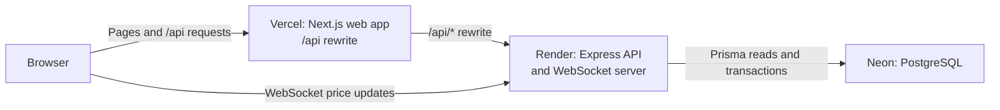
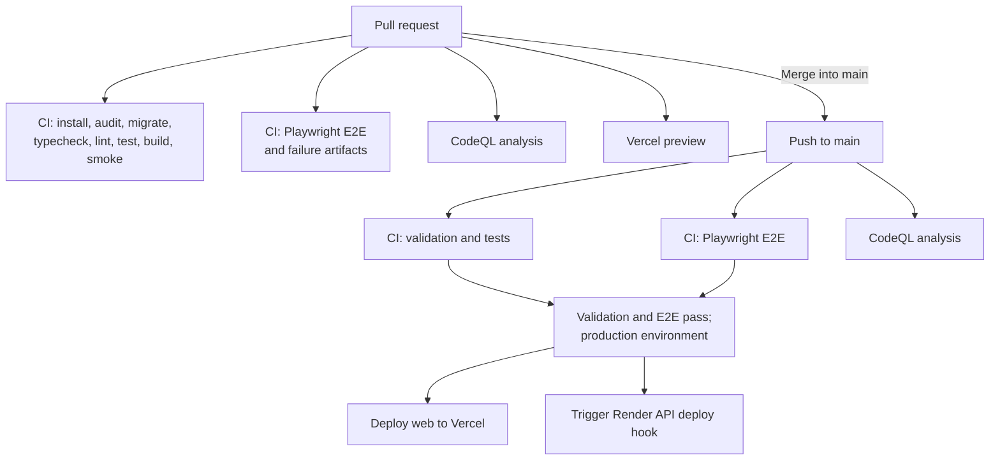

# Architecture

The web app forwards HTTP `/api/*` requests to the configured API. Question
pages connect directly to the configured API host for WebSocket updates.
Authentication uses an HttpOnly cookie; the API enforces authorization and
performs prediction and credit operations against PostgreSQL. See the
[database schema](SCHEMA.md) for the data model.

## CI/CD

The CI and CodeQL workflows also run independently on `main`; the deployment
jobs depend on CI's `validate` and `e2e` jobs. Vercel preview deployments are separate
from GitHub Actions validation and use the configured preview API. Current
preview settings use the shared deployed API, not an isolated preview database.
Deployment credentials and application secrets are managed in provider and
GitHub environment settings, not in this repository.
