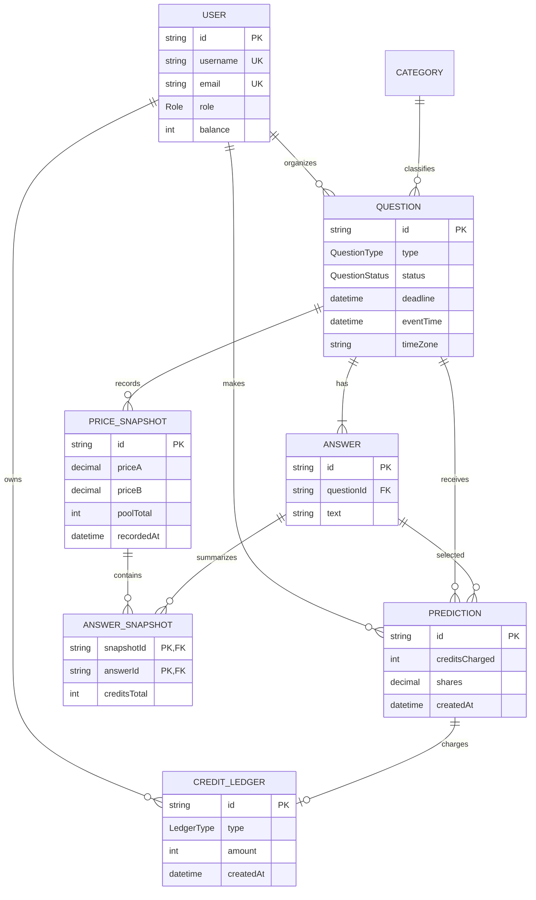

# ForecastHub database schema

The Prisma schema in [`apps/api/prisma/schema.prisma`](../apps/api/prisma/schema.prisma)
stores the core domain and keeps prediction and credit history append-only.

`DateTime` values are stored as instants by PostgreSQL. `timeZone` is retained
on each question so clients consistently display deadlines and event times in
Pacific Time. `Prediction`, `CreditLedger`, and snapshot rows have no update
operation in the application model; corrections and refunds must be represented
by new ledger entries.
