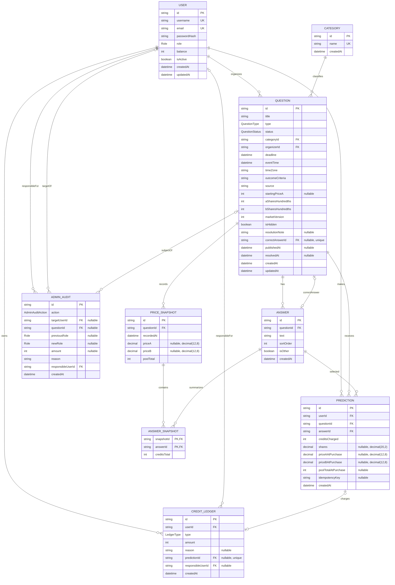

# ForecastHub database schema

The source of truth is [`schema.prisma`](../apps/api/prisma/schema.prisma).
The diagram includes all models and scalar fields; nullable and unique fields
are marked in descriptions.

`Answer` enforces uniqueness for `(questionId, text)` and
`(questionId, sortOrder)`. `Prediction` has a unique
`(userId, idempotencyKey)` constraint, and `AnswerSnapshot` has a composite
primary key `(snapshotId, answerId)`. See the Prisma schema for indexes,
defaults, relation deletion behavior, and enum values.

`DateTime` values represent instants; each question also stores a `timeZone`
whose default is `America/Los_Angeles`. The application retains prediction
and ledger history, recording payouts, corrections, and refunds as ledger
entries. Some schema fields and enum values support features deferred from the
current A/B-only release; their presence does not mean those features are live.
